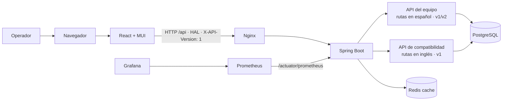
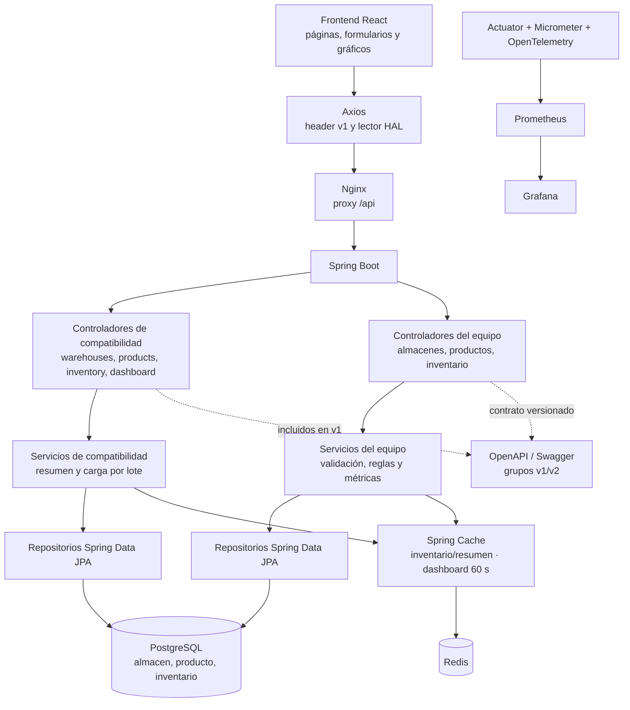
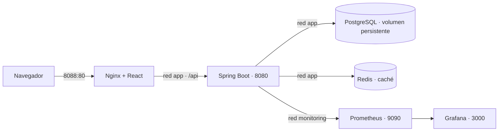

# Arquitectura implementada

El backend expone dos contratos HTTP diferenciados: la API del equipo con rutas en español y versiones v1/v2, y las rutas en inglés que necesita el frontend, limitadas a v1. Ambas aplicaciones usan el mismo esquema PostgreSQL, pero conservan sus controladores, servicios, DTO y repositorios. Los componentes de infraestructura están configurados en el repositorio; su ejecución depende del entorno.

## Contexto

## Componentes

Las rutas de compatibilidad y las del equipo no colisionan. Las escrituras de ambas superficies invalidan el resumen compartido del dashboard para que las lecturas posteriores reflejen el estado persistido.

## Despliegue Docker Compose configurado

Las redes `app` y `monitoring` son internas; `edge` publica frontend, Prometheus y Grafana. PostgreSQL y Redis no publican puertos de host. El volumen PostgreSQL y los volúmenes de datos de Prometheus/Grafana están declarados en Compose. El backend se sirve solo internamente y Nginx reenvía el prefijo `/api` conservándolo.
